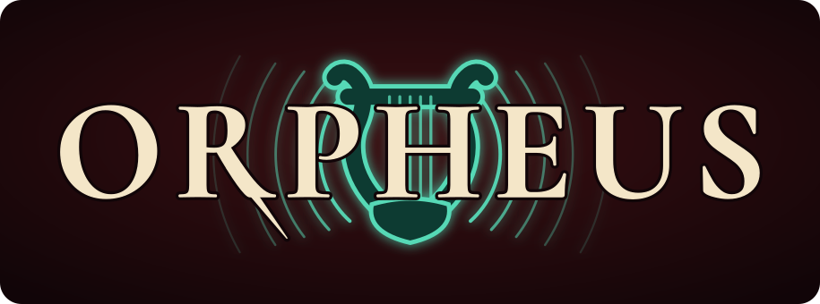

<div align="center">
  <h1></h1>
  <p><b>O</b>pen <b>R</b>ealtime <b>P</b>eer-to-peer <b>H</b>ome <b>E</b>thernet <b>U</b>nicast <b>S</b>treaming</p>
</div>

Orpheus is a decentralized audio-over-IP network for the home. Every device is
a node that can send and play audio, and there is no central server. On wired
networks the nodes speak AES67: RTP with linear PCM, synchronized by PTP. That
makes rooms play in sync and keeps latency low enough for video.

This repository holds the shared core and the Linux node, which is built on
PipeWire. ESP32 receivers, a web UI and Wi-Fi operation are planned; see the
[roadmap](docs/roadmap.md).

**Status:** early development. Two Linux nodes can stream to each other over
RTP unicast (IPv4 or IPv6; multicast only for AES67/Dante interop), with the
clock synchronized over PTP and sample-rate conversion against the sound
cards' clocks. Nodes find each other over mDNS and speak NMOS (IS-04,
IS-05), so routes can be set with `orpheusctl`, which connects both ends, or
an NMOS controller; they are kept across restarts. There is no
authentication and no UI yet.

## Quick start

You need Rust (edition 2024), PipeWire with its development headers, and
clang (for the PipeWire bindings).

```sh
cargo build --release
# PTP uses the privileged ports 319 and 320. Redo this after every build.
sudo setcap cap_net_bind_service=+ep target/release/orpheusd
target/release/orpheusd
```

Without the capability the node still runs, but it falls back to the system
clock; see [clock](docs/clock.md).

Both binaries, `orpheusd` and `orpheusctl`, end up in `target/release`. On a
second machine, start `orpheusd` the same way, with `name = "Kitchen"` in
its [config](docs/configuration.md). Then send the first machine's audio to
it:

```sh
orpheusctl nodes           # other nodes on the network
orpheusctl connect Kitchen
```

This creates a sink "Kitchen" on the first machine and connects the second
machine's receiver to it. Whatever is played into the sink comes out of the
second machine's default output.

```sh
orpheusctl status          # clock, receiver and senders
orpheusctl status --watch  # the same, refreshed every second
orpheusctl disconnect 0    # stop sender 0, disconnect the receiver
```

`orpheusctl` talks to `http://localhost:7480` by default. Use `--node URL`
or `ORPHEUS_NODE` to query another node.

Sinks to other nodes use the icon `orpheus-network-speaker`, which icon
themes don't have. Install it with the other icons from
[`orpheusd/dist/icons`](orpheusd/dist/icons/README.md).

To start the node with your session, install the systemd user unit from
[`orpheusd/dist/orpheusd.service`](orpheusd/dist/orpheusd.service); adjust
`ExecStart` if the binary is not in `/usr/bin`.

## Documentation

- [Configuration](docs/configuration.md): files, `~/.config/orpheus/config.toml`
- [Usage](docs/usage.md): `orpheusctl`, the HTTP API, reading the status
- [Clock](docs/clock.md): PTP, TAI, settling, fallback, IPv4 and IPv6
- [Architecture](docs/architecture.md): crates, threads, the audio path
- [Troubleshooting](docs/troubleshooting.md)
- [Development](docs/development.md): building and tests
- [Roadmap](docs/roadmap.md): milestones, known limitations, future work

## License

GPL-3.0-or-later.
